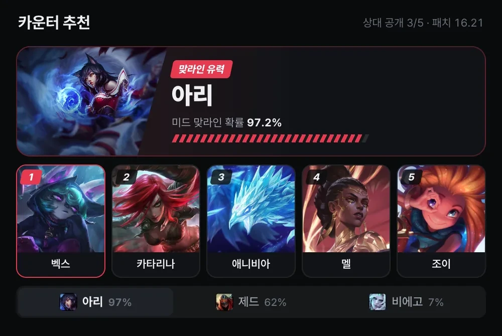
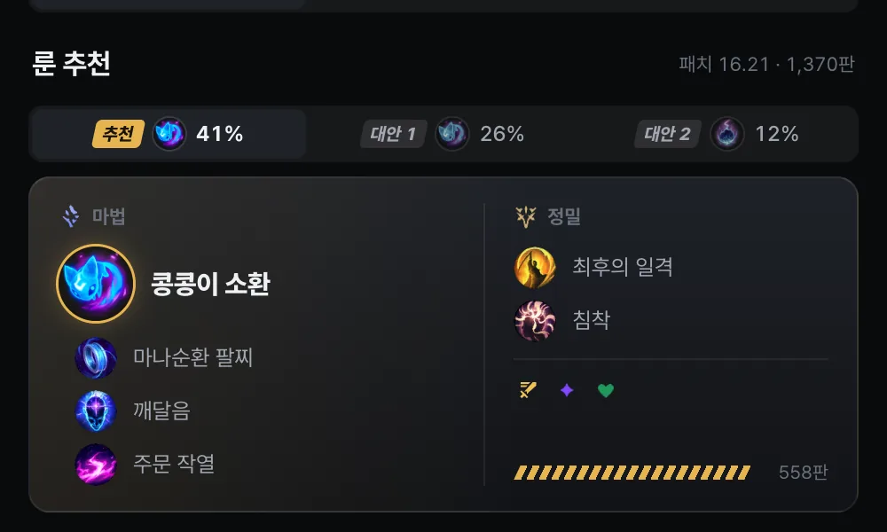
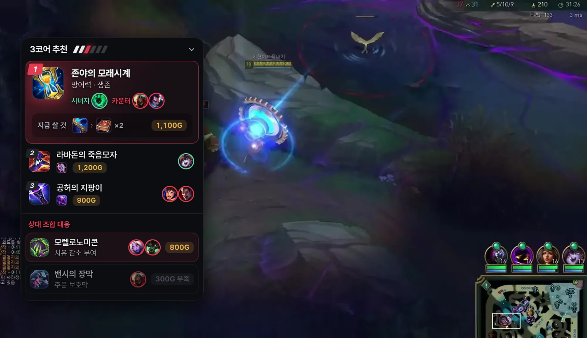
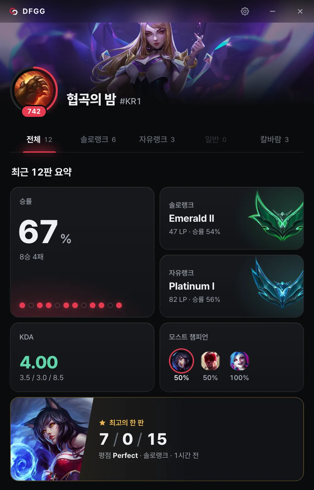
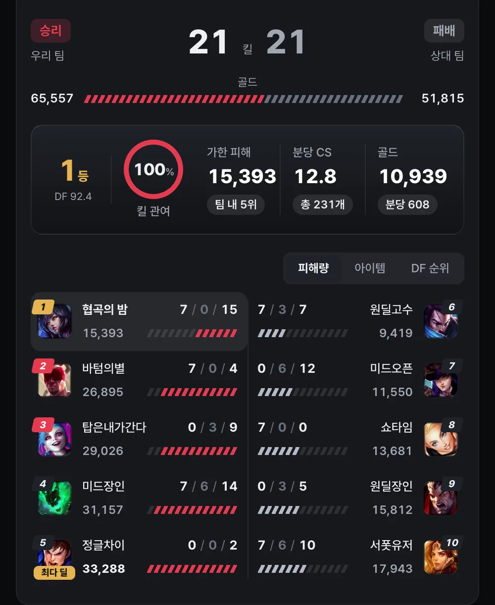
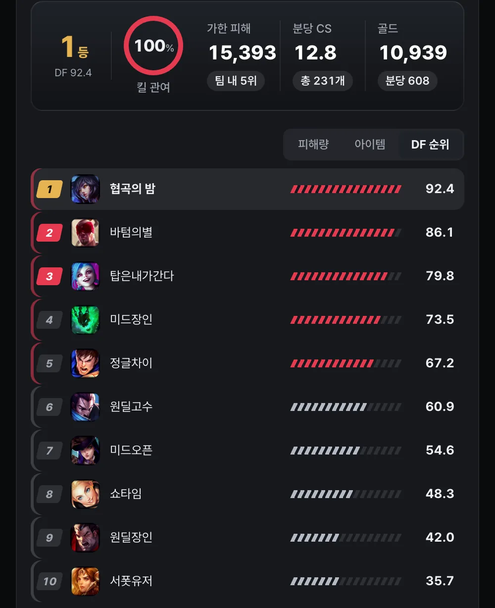
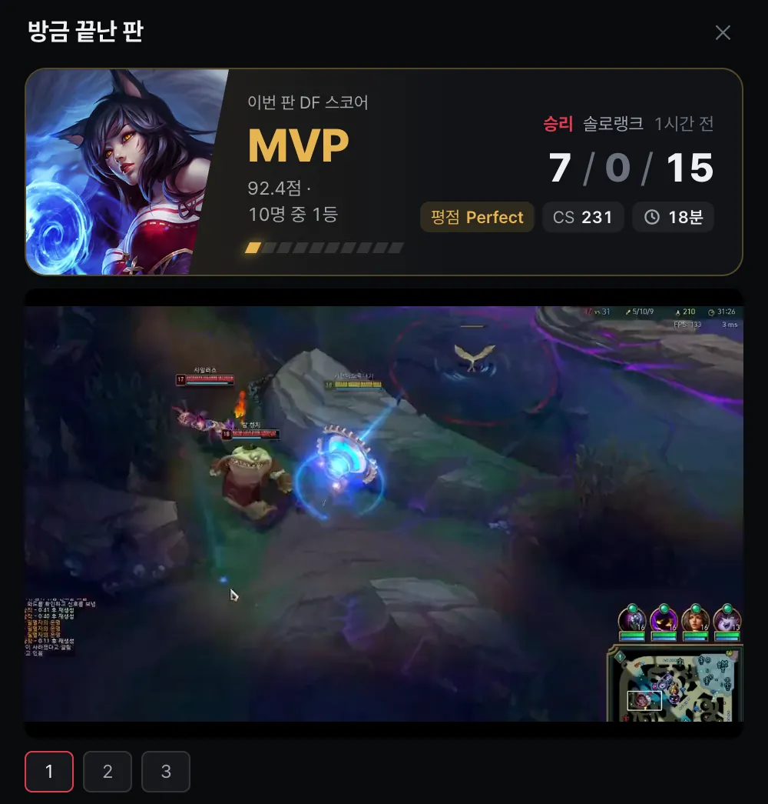
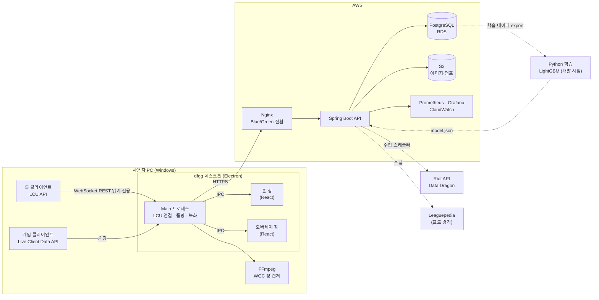

<div align="center">


# dfgg

**지금 내 게임의 10명을 보고 아이템 빌드를 추천하는 리그 오브 레전드 데스크톱 앱**

[서비스 바로가기](https://www.dfgg.pro/) · [Windows 앱 다운로드](https://github.com/woowacourse-teams/2026-dfgg/releases/latest)


</div>

<br>

## 목차

1. [프로젝트 소개](#프로젝트-소개)
2. [주요 기능](#주요-기능)
3. [시스템 아키텍처](#시스템-아키텍처)
4. [기술적 도전](#기술적-도전)
5. [기술 스택](#기술-스택)
6. [프로젝트 구조](#프로젝트-구조)
7. [시작하기](#시작하기)
8. [팀원](#팀원)
9. [Riot Games 정책 준수](#riot-games-정책-준수)

<br>

## 프로젝트 소개

### 문제

한국 서버 플레이어의 약 36%가 아이언~실버 구간에 있습니다. 사용자 조사에서 이 구간의 공통된 어려움 두 가지를 확인했습니다.

1. **메타를 따라가기 어렵다.** 패치마다 아이템이 바뀌는데, 외워 둔 빌드가 틀려졌다는 사실을 알아채기 어렵습니다.
2. **아이템을 왜 사는지 모른다.** 빌드 순서는 외워도 이유를 몰라서, 상대 팀에 회복·CC·방어력이 많을 때 빌드를 바꾸지 못합니다.

기존 서비스(OP.GG, GGQ, LOL.PS)를 정글·미드·서포터로 직접 플레이하며 비교한 결과, 공통적으로 다음 한계가 있었습니다.

| 한계 | 관찰 내용 |
| --- | --- |
| 추천이 일찍 끝남 | 2~3번째 코어 이후로는 순위 없는 후보 목록만 보여줌 |
| 근거가 없음 | 빌드는 보여주지만 *이 상대 조합에서 왜* 이 아이템인지 설명하지 않음 |
| 포지션 사각지대 | 서포터 아이템 누락, 정글 동선 제약 미반영 |
| 정보 과부하 | 화면 정보가 많아 밴픽 시간 안에 필요한 것을 찾기 어려움 |

기존 서비스는 "많은 사람이 산 빌드"라는 **통계를 보여주는 데서 멈춥니다.** dfgg는 그다음 단계인 **상황 판단**을 목표로 합니다.

### 해결

dfgg는 고정된 평균 빌드 대신, **내 게임에 실제로 있는 10명의 챔피언**과 **지금 내가 가진 아이템**을 기준으로 다음에 살 아이템을 추천합니다. 추천마다 "상대 탱커가 많아서", "아군 ○○와 시너지" 같은 한 줄 근거를 함께 보여줍니다.

<br>

## 주요 기능

### 1. 밴픽 도우미 (챔피언 선택 단계)

롤 클라이언트 옆에 자동으로 붙는 창에서 밴픽 정보를 실시간으로 보여줍니다.

- **카운터 추천**: 상대가 공개한 챔피언마다 현재 패치의 라인 분포와, 내 포지션에서 그 챔피언을 상대하기 좋은 픽을 추천
- **룬 추천**: 확정한 챔피언·포지션에 맞는 룬 페이지 추천
- **오늘의 프로 픽**: 최근 프로 대회에서 내 라인으로 승리한 픽을 아이템·룬·스펠과 함께 소개

| 카운터 추천 | 룬 추천 |
| :---: | :---: |
|  |  |

### 2. 인게임 아이템 오버레이

- 게임 화면 위의 작은 오버레이에 **다음에 살 아이템**과 구성품 구매 순서를 표시
- 현재 보유 아이템이 바뀔 때마다 추천을 갱신하며, 각 추천에 한 줄 근거를 붙임
- 언제든 접을 수 있고, 게임에 입력을 보내지 않음

<p align="center">
  
</p>

### 3. 전적 · DF 스코어

- 로컬 클라이언트에서 내 프로필, 랭크, 최근 전적을 읽어 보여줌
- 경기마다 **DF 스코어**(큐별 채점 모델로 계산한 경기 기여도 점수)와 배지를 부여

| 홈 | 경기 상세 | DF 순위 |
| :---: | :---: | :---: |
|  |  |  |

### 4. 게임 하이라이트

- 게임 중 롤 창만 녹화하고, 게임이 끝나면 **내 킬·어시스트·오브젝트 장면**을 자동으로 잘라 하이라이트로 저장
- 녹화·인코딩·저장은 **모두 사용자 PC에서만** 이뤄지며 서버로 업로드하지 않음
- 최근 20게임만 보관, 클립 생성 후 원본 삭제, 디스크 여유 공간이 부족하면 녹화 생략

<p align="center">
  
</p>

<br>

## 시스템 아키텍처



<br>

## 기술적 도전

### Backend

#### 1. 매치 타임라인에서 "실제로 산 것"을 복원하는 데이터 정규화

Riot 매치 타임라인에는 구매·판매·되돌리기·합성 이벤트가 섞여 있어, 그대로 집계하면 "완성 아이템을 언제 어떤 순서로 샀는지"를 알 수 없습니다.

- 이벤트를 순서대로 재생하며 **인벤토리를 재구성**하고, 하위 아이템이 상위 아이템 재료로 소모되는 관계를 레시피로 연결
- 구매 시점의 **보유 골드 범위를 추정**해 구매 유형(코어·상황템·신발 등)을 분류
- 패치 단위 재정규화 배치를 두어, 규칙이 바뀌어도 원본(raw) 데이터에서 다시 계산할 수 있게 설계

#### 2. 후보 생성 → 필터 → 랭킹으로 나눈 추천 파이프라인

추천을 한 번의 통계 조회가 아니라 검색 시스템처럼 단계로 나눴습니다.

| 단계 | 내용 |
| --- | --- |
| 후보 생성 | 내 챔피언 기준 빌드, **아군 시너지**, **상대 카운터** 생성기가 각각 후보를 만들고 합침. 표본이 적으면 조건을 단계적으로 완화(back-off) |
| 하드 필터 | 이미 보유한 아이템, 중복 불가 아이템 그룹 등 규칙상 불가능한 후보 제거 |
| 랭킹 | 상대 조합의 CC·회복·AD/AP 비율·탱커 수 등 피처로 **LambdaMART** 모델이 순위 결정 |
| 설명 | **TreeSHAP**으로 피처 기여도를 계산해, 가장 크게 작용한 근거를 한 줄 설명으로 변환 |

v4에서는 코어 아이템 순서를 유지하면서, 현재 보유 상태와 목표 아이템 쌍마다 **구성품 구매 순서**를 별도 모델로 추천합니다.

#### 3. Python 학습 · Java 서빙 분리와 학습-서빙 불일치 차단

- 피처 계산은 **Java 한 곳에서만** 수행하고, Python(LightGBM)은 Java가 내보낸 피처 벡터로 학습만 합니다.
- 학습된 트리를 평탄한 JSON 배열로 내보내고 Java에서 직접 추론합니다. 운영 서버와 CI/CD는 Python 없이 동작합니다.
- 피처 이름·순서가 Java `enum`과 다르면 **서버 기동 단계에서 실패**하도록 해 조용한 오작동을 막았고, Python 예측과 Java 예측이 **1e-6 이내**로 일치하는지 parity 테스트로 검증합니다.
- 실제 매치 덤프를 대상으로 하는 오프라인 평가(`evaluationTest`)를 일반 테스트와 분리해, CI는 빠르게 유지하고 추천 품질은 별도로 비교합니다.

#### 4. 무중단 배포와 운영 관측성

- EC2 self-hosted runner에서 **Nginx 업스트림을 전환하는 Blue/Green 배포**. 전환 실패 시 자동 복구 결과(`restored`/`new-slot-active`/`uncertain`)를 남깁니다.
- dev 배포 후 **5분 soak 검증**(readiness, OpenAPI 응답, 프로세스 재시작 여부)을 통과해야 prod 승인 단계로 넘어갑니다.
- Actuator·Micrometer → Prometheus → Grafana 대시보드·알림, CloudWatch 에이전트로 지표와 로그를 수집합니다.
- **k6 부하 테스트** 환경을 prod와 같은 사양으로 분리 구성하고, 고정된 S3 데이터 덤프로 개선 전후를 같은 조건에서 비교합니다.
- Flyway로 스키마를 버전 관리합니다.

#### 5. Riot API 제약 아래의 데이터 수집

- 스케줄러가 티어·디비전별로 플레이어와 매치를 수집하며, **요청 한도(초당·2분당)를 지키는 실행기**로 호출을 조절합니다.
- 누락된 타임라인을 다시 채우는 복구 단계를 두었습니다.
- 프로 경기 데이터는 Leaguepedia(Cargo API)의 요청 제한에 맞춰 간격과 재시도를 조절해 수집합니다.

### Frontend · Desktop

#### 1. 롤 클라이언트와의 안정적인 연결

- 클라이언트 lockfile에서 포트·인증 정보를 읽어 **LCU WebSocket**에 연결하고, 게임 단계(로비·밴픽·인게임·종료) 이벤트를 구독합니다.
- 클라이언트가 꺼지거나 재시작되면 **지수 백오프로 자동 재연결**하고, 연결 직후 현재 단계를 다시 동기화합니다.
- Electron main 프로세스가 연결과 상태를 소유하고, 홈·오버레이 창은 IPC로 상태만 받도록 역할을 나눴습니다.

#### 2. 로컬 하이라이트 파이프라인

`녹화 → 이벤트 수집 → 클립 계획 → 자르기 → 라이브러리 저장`

- FFmpeg의 **Windows Graphics Capture**로 롤 게임 창만 녹화하고, GPU 하드웨어 인코더를 감지해 사용합니다. 게임 프로세스에 코드를 주입하지 않습니다.
- Live Client Data의 이벤트 시각과 녹화 시작 시각으로 **게임 시간과 영상 시간을 맞추고**, 가까운 이벤트를 하나의 클립으로 묶습니다.
- 앱이 비정상 종료돼도 이벤트 로그(JSONL)의 깨진 줄을 건너뛰고 복구할 수 있게 했습니다.
- 디스크 공간 확인, 보관 개수 제한, 원본 삭제로 사용자 PC 자원을 관리합니다.

#### 3. 클라이언트 도킹 창

- 네이티브 모듈로 롤 클라이언트 창의 위치를 추적해 dfgg 창을 옆에 붙이고, 드래그가 멈춘 직후 좌표까지 반영되도록 throttle을 직접 구현했습니다.
- 네이티브 모듈 로드에 실패해도 도킹만 비활성화되고 나머지 기능은 동작하도록 격리했습니다.

#### 4. 가짜 롤 서버로 만든 테스트 환경

실제 롤 클라이언트 없이 데스크톱 앱 전체 흐름을 검증하기 위해 테스트용 서버를 직접 만들었습니다.

- **가짜 LCU 서버**(HTTPS·WebSocket·lockfile), **가짜 Live Client 서버**, **가짜 Data Dragon**, **가짜 백엔드**
- 단위 테스트(Vitest) → 통합 테스트(연결·밴픽·인게임·게임 종료·종료 처리) → **Playwright E2E**(앱 실행부터 게임 종료까지)

#### 5. 배포와 운영

- 하나의 pnpm 워크스페이스에서 **웹(랜딩)·데스크톱·관리자 대시보드**와 공용 패키지를 관리합니다.
- electron-builder로 **NSIS 설치 파일과 MS Store(APPX)** 패키지를 만들고, GitHub Releases 기반 **자동 업데이트**를 지원합니다.
- Sentry(에러), Umami·PostHog(사용 지표)로 운영 상태를 확인하고, 관리자 대시보드에서 퍼널과 지표를 봅니다.
- 웹은 CI(lint·format·typecheck·build) 통과 후 dev 배포 → 대기 → prod 배포 순서로 반영됩니다.
- 한국어·영어 다국어를 지원합니다.

<br>

## 기술 스택

| 구분 | 기술 |
| --- | --- |
| **Backend** | Java 21, Spring Boot 4, Spring Data JPA, PostgreSQL 16, Flyway, springdoc-openapi |
| **ML** | Python 3.12, LightGBM (LambdaMART), uv, pytest |
| **Desktop** | Electron, React 19, TypeScript, Webpack, FFmpeg (LGPLv3), electron-updater, electron-overlay-window, koffi |
| **Web · Admin** | React 19, TypeScript, Tailwind CSS 4, Motion |
| **Test** | JUnit 5, RestAssured, Vitest, Playwright, k6 |
| **Infra** | AWS EC2 · RDS · S3, Nginx, GitHub Actions (self-hosted runner) |
| **Monitoring** | Actuator, Prometheus, Grafana, CloudWatch, Sentry, Umami, PostHog |
| **External Data** | Riot API (ACCOUNT-V1, SUMMONER-V4, LEAGUE-V4, MATCH-V5, CHAMPION-MASTERY-V4, SPECTATOR-V5), Data Dragon, Leaguepedia |

<br>

## 프로젝트 구조

```
2026-dfgg/
├── docs/images/                # README 이미지
├── frontend/                   # pnpm 워크스페이스
│   ├── apps/
│   │   ├── desktop/            # Electron 앱
│   │   │   ├── src/main/       #   LCU·Live 연결, 하이라이트, 도킹, 자동 업데이트
│   │   │   ├── src/renderer/   #   홈 창, 오버레이 창 (React)
│   │   │   └── test/           #   가짜 LCU·Live 서버, 통합·E2E 테스트
│   │   ├── web/                # 랜딩·다운로드 페이지
│   │   └── admin/              # 사용 지표 관리자 대시보드
│   └── packages/shared/        # 공용 API 클라이언트·타입
│
└── backend/
    ├── dfgg/                   # Spring Boot API
    │   └── src/main/java/dfgg/
    │       ├── presentation/   #   REST 컨트롤러
    │       ├── application/    #   수집·정규화·추천·채점 서비스
    │       ├── domain/         #   도메인 모델·정책
    │       └── infrastructure/ #   Riot·Leaguepedia 클라이언트, 설정, 스케줄러
    ├── ml/                     # LTR 모델 학습 (개발 시점 전용)
    └── ops/                    # Nginx, Prometheus, Grafana, CloudWatch, k6
```

<br>

## 시작하기

### Frontend

Node.js 24, pnpm 10이 필요합니다.

```bash
cd frontend
pnpm install

pnpm start          # 웹 개발 서버
pnpm desktop:dev    # 데스크톱 앱 개발 실행
pnpm admin          # 관리자 대시보드

pnpm --filter desktop test      # 단위·통합 테스트
pnpm --filter desktop test:e2e  # E2E 테스트
```

### Backend

JDK 21, Docker가 필요합니다.

```bash
cd backend/dfgg
cp .env.example .env    # DB 정보, RIOT_API_KEY 등 입력
docker compose up -d    # 로컬 PostgreSQL

./gradlew bootRun
./gradlew test
```

API 문서는 서버 실행 후 `/swagger-ui/index.html`에서 확인할 수 있습니다.

### ML (모델 재학습 시에만)

```bash
cd backend/ml
uv sync
uv run python -m dfgg_ltr.train --split game --out ../dfgg/src/main/resources/ltr/model.json
```

자세한 절차는 [`backend/ml/README.md`](backend/ml/README.md)를 참고하세요.

<br>

## 팀원

[우아한테크코스](https://woowacourse.github.io/) 8기 4인 팀 프로젝트입니다.

| Frontend | Frontend | Backend | Backend |
| :---: | :---: | :---: | :---: |
|  |  |  |  |
| [JuHyeong424](https://github.com/JuHyeong424) | [hjkim0905](https://github.com/hjkim0905) | [K-iise](https://github.com/K-iise) | [yItWorks](https://github.com/yItWorks) |

<br>

## Riot Games 정책 준수

- dfgg는 플레이어가 밴픽 화면과 인게임 스코어보드에서 **이미 볼 수 있는 정보만** 사용합니다.
- 로컬 API(LCU, Live Client Data)는 **읽기 전용**으로만 사용하며, 클라이언트에 쓰거나 동작을 자동화하지 않습니다.
- 하이라이트는 사용자 화면에서 녹화하며 사용자 PC에만 저장됩니다.
- 데스크톱 앱은 수정하지 않은 FFmpeg 빌드(BtbN, LGPLv3, GPL 구성요소 없음)를 포함하며, 라이선스 전문은 `resources/ffmpeg/`에 함께 배포됩니다.

> dfgg isn't endorsed by Riot Games and doesn't reflect the views or opinions of Riot Games or anyone officially involved in producing or managing Riot Games properties. Riot Games, and all associated properties are trademarks or registered trademarks of Riot Games, Inc.
